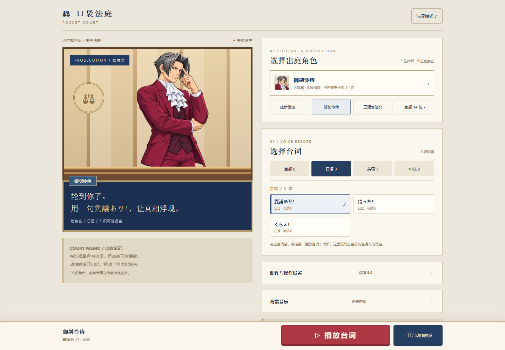
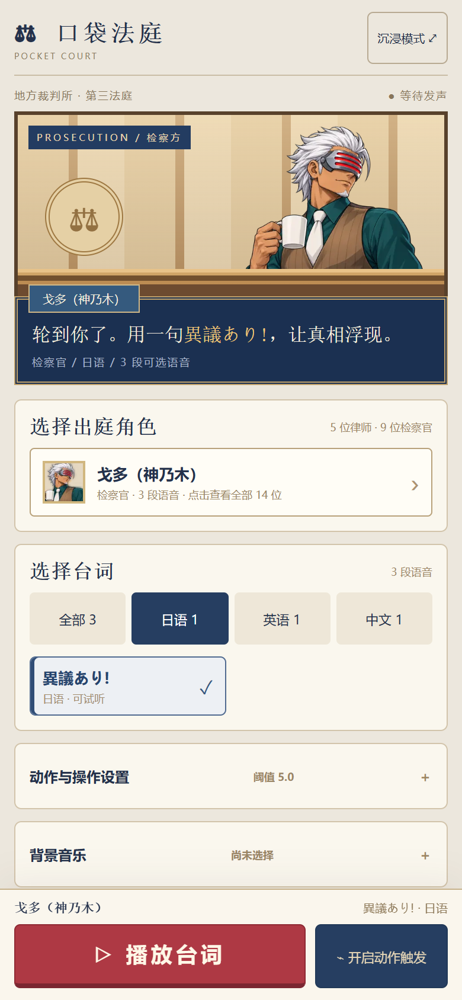

# 口袋法庭 · Pocket Court

**把法庭装进口袋，用一句异议登场。**

一款以《逆转裁判》为灵感的浏览器语音互动工具。选择出庭角色与台词，点击按钮或挥动手机，播放角色语音与台词特效。米金色法庭、深蓝对话框和木质栏杆，让每次发声都有开庭的仪式感。

**[立即体验 →](https://xyd-0811.github.io/Pocket-Court/)** · 无需安装 · 手机与电脑均可使用

## 界面预览

### 电脑端

左右双栏展示法庭舞台与角色、台词选择区，底部固定保留播放和动作触发按钮。



### 手机端

紧凑舞台、两列台词与底部操作栏，方便单手点击；全部角色通过可搜索的人物名单选择。

<p>
  
  
</p>

## 能做什么

| 功能 | 说明 |
| --- | --- |
| 角色与台词 | 14 位角色、20 种台词，共 81 段语音；按角色实际支持的日语、英语、中文筛选 |
| 人物立绘 | 14 位角色使用统一画风的专属立绘；手机与电脑分别加载合适尺寸的 WebP，先显示即时预览，再补清晰图片，空闲时逐张预载 |
| 动作发声 | 支持手机动作触发、阈值调节、峰值查看与归零，也可手动播放或模拟挥动 |
| 台词演出 | 播放对应台词图与语音，在支持的设备上提供震动反馈 |
| 本地音乐 | 从设备选择一首或多首音乐，支持播放、暂停、切歌、循环、音量和进度调整 |
| 沉浸模式 | 隐藏操作界面，专注法庭舞台；双击舞台可切换，电脑端支持 Esc 退出 |
| 偏好与缓存 | 保存角色、台词和操作偏好，支持语音缓存与缓存清理 |

## 怎么玩

1. 打开 **[在线网站](https://xyd-0811.github.io/Pocket-Court/)**，点击角色卡选择出庭人物。
2. 选择语言与台词，点击底部「播放台词」。
3. 如需挥动发声，点击「开启动作触发」并允许浏览器使用动作传感器；在「动作与操作设置」中调整阈值。
4. 展开「背景音乐」，选择设备里的音乐，配合台词播放。

手机动作感应需要 HTTPS、设备和浏览器支持，并可能要求授权。建议先点击一次「播放台词」开启声音，再使用动作触发。设备不支持感应时，可使用按钮或「模拟挥动」。震动反馈同样取决于设备与浏览器支持。

背景音乐仅在本机读取，不上传；刷新页面后需要重新选择音乐。桌面端可在舞台区域使用鼠标触发，按 `Ctrl + Shift + Z` 切换开关。

## 本地运行

这是一个由 HTML、CSS 和 JavaScript 构成的静态网站，无需后端或依赖安装。下载仓库后，可直接打开 `index.html` 试听，也可以在仓库根目录启动静态服务器：

```bash
python -m http.server 8000
```

Windows 也可以使用 `py -m http.server 8000`。随后在电脑浏览器访问 **http://localhost:8000/**。手机体验动作感应请使用上方在线 HTTPS 网站。

## 项目结构

```text
Pocket-Court/
├── index.html              # 网站入口
├── manifest.json           # 应用名称与主题配置
├── vibe-coding/
│   ├── app.js              # 语音、音乐、动作与界面交互
│   ├── catalog.js          # 角色与台词目录
│   ├── styles.css          # 电脑与手机响应式样式
│   └── assets/             # 页面立绘
├── img/                    # 台词图片
├── sound/                  # 角色语音
└── docs/images/            # README 界面截图
```

## 致谢与许可

本项目基于 [Shoyu / Portable-objection](https://github.com/shoyu3/Portable-objection) 重制，保留原项目的角色语音与台词资源，并重新设计了法庭风格界面及移动端交互。

项目保留 [MIT 许可证](LICENSE) 与原作者署名。
